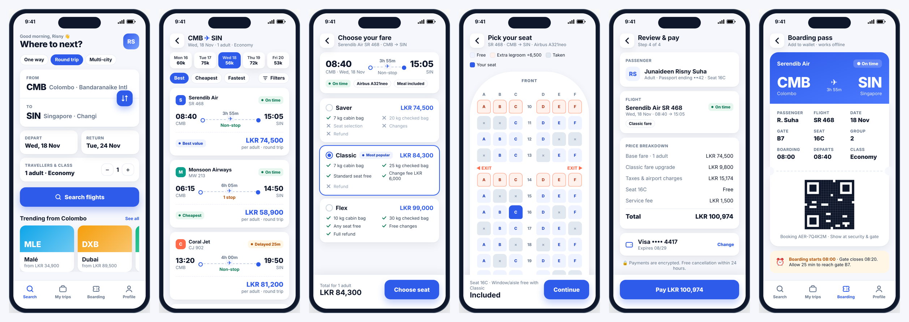
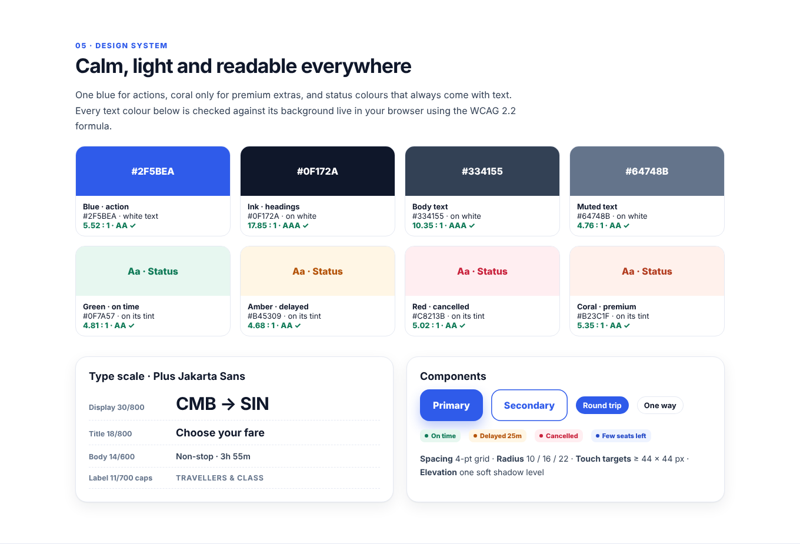

<div align="center">

# ✈️ Aerio: Flight Booking App · UI/UX Case Study

### Search, compare fares, pick a seat on a real cabin map, see every rupee, and fly with an offline boarding pass


**[▶ Case study](https://devrisny.github.io/Aerio-Flight-Booking-UX/)** · **[📱 Clickable prototype](https://devrisny.github.io/Aerio-Flight-Booking-UX/prototype.html)**
Pynexia Tech · UI/UX Design Internship · Week 4: Travel UX & End-to-End Prototyping



</div>

---

## 🎯 The brief → what was delivered

| Brief requirement | Where it lives in Aerio |
|---|---|
| Flight searching | **Search**: from/to with one-tap swap, trip type, travellers & class |
| Date selection | **Fare calendar**: lowest price on every date, cheap days in green, a "fly a day earlier and save" tip |
| Fare comparison | **Results**: Best / Cheapest / Fastest sort plus a 5-day price strip. **Fare screen**: Saver / Classic / Flex as an aligned ✓ / ✕ checklist |
| Flight listings with departure/arrival timelines | Every result card has a dep → arr timeline, duration and stops |
| Airline status tags | *On time*, *Delayed 25m*, *Few seats left*, always colour **plus** text |
| Cabin seat-selection map | **Seat map**: A321neo layout, exit rows, extra-legroom pricing, taken seats marked "×", accessible labels |
| Price breakdowns | **Review & pay**: base, fare upgrade, taxes, seat and fee, then a total that matches the Pay button |
| Digital boarding pass | **Boarding pass**: route, gate, seat, group, boarding time, live status, QR code and a gate-closing reminder |
| Booking management | **My trips**: check-in progress tracker, change seat, add bags, change date, cancel |

## 🧭 Process

1. **Problem framing**: a heuristic review of booking flows found four pain points: hidden costs, unclear fares, confusing seat maps and scattered trip info.
2. **Personas**: *Nadeesha* (budget student traveller) and *Arjun* (frequent business flyer).
3. **User flow**: 7-step happy path with manage-booking loops back into the same screens.
4. **Low-fi wireframes** for the 4 hardest screens, to fix information order before style.
5. **Design system**: tokens, type scale, components. Every colour pair is **contrast-checked live** on the case-study page.
6. **High-fidelity UI + clickable prototype**: all 9 screens connected, with real state (swap airports, choose dates, sort, fare, seat, pay).
7. **Usability test plan**: 5 tasks with success criteria, SEQ and SUS.

<p align="center"></p>

## 💡 Key design decisions

- **The total price is never hidden.** A sticky price bar runs from fare choice to payment, and the Pay button repeats the exact total.
- **Fares as a checklist.** The same 5 rows sit in the same positions, so you compare by scanning, not reading.
- **The seat map works for everyone.** 38 px seats, row numbers in the aisle, "×" for taken seats (not colour only) and an `aria-label` on every seat.
- **Status = colour + words.** Status is readable at a glance and safe for colour-blind users.
- **One offline boarding pass.** Everything you need at the airport is on a single card.

## 📱 Try it

Open **[the prototype](https://devrisny.github.io/Aerio-Flight-Booking-UX/prototype.html)** and tap through:
*Search flights → pick a flight → choose a fare → choose a seat → Continue → Pay → View boarding pass.*
Use the screen list on the right to jump anywhere. **Esc** goes back.

Run it locally with no build step:

```bash
python -m http.server -d docs 8000   # then open http://localhost:8000
```

## 🗂️ Files

```
docs/
├── index.html        # case study (problem, personas, flow, wireframes, design system, screens, decisions, test plan)
├── prototype.html    # clickable prototype
├── prototype.js      # 9 screens + state machine
├── prototype.css     # design tokens & components
├── screens/          # 9 high-fidelity PNG exports (2×)
└── assets/           # images used in this README
```

## 👩‍💻 Designer

**Junaideen Risny Suha** · HDIT, ICST Sri Lanka
[GitHub @DevRisny](https://github.com/DevRisny) · [LinkedIn](https://www.linkedin.com/in/risny-suha-8a6b66423)

<sub>Airlines (Serendib Air, Monsoon Airways, Coral Jet), booking references and the QR pattern are fictional, for demonstration only.</sub>
